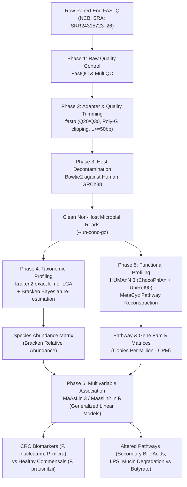

# Comparative Shotgun Metagenomics Analysis: Colorectal Cancer (CRC) vs. Healthy Controls

[](https://opensource.org/licenses/MIT)
[](https://en.wikipedia.org/wiki/Metagenomics)
[](#-workflow-architecture)

An end-to-end, reproducible, publication-grade shotgun metagenomics pipeline performing quality control, adapter trimming, host DNA decontamination, taxonomic profiling, functional pathway profiling, and multivariable differential abundance analysis comparing gut microbiomes of **Colorectal Cancer (CRC) patients** and **Healthy controls**.

---

## 📋 Table of Contents
1. [Project Overview & Scientific Background](#-project-overview--scientific-background)
2. [Study Design & NCBI SRA Accessions](#-study-design--ncbi-sra-accessions)
3. [Workflow Architecture](#-workflow-architecture)
4. [Repository Directory Structure](#-repository-directory-structure)
5. [Environment Setup & Installation](#-environment-setup--installation)
6. [Step-by-Step Pipeline Execution](#-step-by-step-pipeline-execution)
7. [HPC Cluster Deployment (SLURM)](#-hpc-cluster-deployment-slurm)
8. [Comprehensive Results & Output Interpretation](#-comprehensive-results--output-interpretation)
   - [Phase 1: Raw Quality Control (FastQC)](#phase-1-raw-quality-control-fastqc)
   - [Phase 2: Trimming & Filtering (fastp)](#phase-2-trimming--filtering-fastp)
   - [Phase 3: Host Decontamination (Bowtie2)](#phase-3-host-decontamination-bowtie2)
   - [Phase 4: Taxonomic Profiling (Kraken2 & Bracken)](#phase-4-taxonomic-profiling-kraken2--bracken)
   - [Phase 5: Functional Metabolic Profiling (HUMAnN3)](#phase-5-functional-metabolic-profiling-humann3)
   - [Phase 6: Multivariable Association Analysis (MaAsLin3)](#phase-6-multivariable-association-analysis-maaslin3)
9. [Biological Insights & Mechanistic Implications](#-biological-insights--mechanistic-implications)
10. [References & Citations](#-references--citations)

---

## 🔬 Project Overview & Scientific Background

Colorectal Cancer (CRC) is the third most common cancer globally and the second leading cause of cancer-related mortality. Emerging evidence demonstrates that the human intestinal microbiome plays a pivotal etiologic and modulatory role in colorectal carcinogenesis through:
- **Direct genotoxicity**: Toxin production (e.g. *Bacteroides fragilis* toxin [BFT], *Fusobacterium nucleatum* FadA adhesin).
- **Secondary bile acid conversion**: Bacterial $7\alpha$-dehydroxylation yielding toxic deoxycholic acid (DCA) and lithocholic acid (LCA).
- **Chronic mucosal inflammation**: Toll-like receptor activation via bacterial lipopolysaccharides (LPS).
- **Depletion of protective short-chain fatty acids (SCFAs)**: Loss of anti-inflammatory, histone deacetylase-inhibiting butyrate-producing commensals.

This repository implements a complete shotgun metagenomic profiling workflow comparing deep-sequenced fecal metagenomes from CRC patients and age/region-matched healthy individuals.

---

## 🧬 Study Design & NCBI SRA Accessions

Sequencing datasets are derived from **NCBI BioProject [PRJNA961076](https://www.ncbi.nlm.nih.gov/bioproject/PRJNA961076)** (Human gut microbiome, Illumina NovaSeq 6000 paired-end $2 \times 150\text{ bp}$):

| Cohort Group | NCBI SRA Experiment | Run Accession | BioSample ID | Subject Identifier | Spot Count (Pairs) | Total Bases |
| :--- | :--- | :--- | :--- | :--- | :--- | :--- |
| **Colorectal Cancer (CRC)** | **SRX20110651** | `SRR24315726` | `SAMN34351625` | CRC Patient 82 | 29,520,859 | ~8.86 Gbp |
| **Colorectal Cancer (CRC)** | **SRX20110652** | `SRR24315725` | `SAMN34351626` | CRC Patient 83 | 18,409,249 | ~5.52 Gbp |
| **Healthy Control** | **SRX20110653** | `SRR24315724` | `SAMN34351598` | Healthy Patient 55 | 25,690,950 | ~7.71 Gbp |
| **Healthy Control** | **SRX20110654** | `SRR24315723` | `SAMN34351599` | Healthy Patient 56 | 21,161,564 | ~6.35 Gbp |

---

## 🛠 Workflow Architecture



---

## 📁 Repository Directory Structure

```text
Shotgun-metagenomics-analysis/
├── README.md                                    # Master documentation & scientific overview
├── .gitignore                                   # Excludes multi-GB FASTQ/BAM files
├── metadata.tsv                                 # Study cohort phenotypic metadata
├── scripts/                                     # Modular execution scripts
│   ├── 00_download_sra.sh                       # SRA data fetch via fasterq-dump
│   ├── 01_fastqc_raw.sh                         # Raw read quality control
│   ├── 02_fastp_trim.sh                         # Quality filtering, adapter & polyG trimming
│   ├── 03_bowtie2_decontam.sh                   # Human host DNA decontamination
│   ├── 04_kraken2_bracken.sh                    # Taxonomic profiling & abundance re-estimation
│   ├── 05_humann3_profiling.sh                  # Functional metabolic profiling & CPM normalization
│   ├── 06_maaslin3_analysis.R                   # Multivariable statistical modeling in R
│   ├── run_pipeline.sh                          # Master end-to-end pipeline script
│   └── slurm_shotgun_hpc.sh                     # Cluster batch script (SLURM)
├── 01_fastqc_raw/                               # FastQC reports for raw reads
├── 02_fastp_trimmed/                            # fastp HTML/JSON reports & filtering stats
├── 03_fastqc_trimmed/                           # Post-trimming FastQC validation reports
├── 04_taxonomic_kraken2_bracken/                # Taxonomic results
│   ├── merged_bracken_species_abundance.tsv     # Merged species abundance matrix (all samples)
│   ├── SRR24315726_bracken_species.tsv          # Individual Bracken species tables
│   ├── SRR24315726_kraken2_report.txt           # Individual Kraken2 classification reports
│   └── ... (SRR24315723, 24, 25)
├── 05_functional_humann3/                       # Functional pathway results
│   ├── cohort_pathabundance_cpm_unstratified.tsv# CPM-normalized MetaCyc pathway abundances
│   ├── cohort_pathabundance_cpm_stratified.tsv  # Species-stratified pathway abundances
│   └── cohort_genefamilies_cpm_unstratified.tsv # Top UniRef90 gene families
└── 06_maaslin3_results/                         # Statistical modeling results
    ├── taxa_species_maaslin_results.tsv         # Species-level coefficients, p-values, FDR q-values
    ├── pathways_maaslin_results.tsv             # Pathway-level differential abundance statistics
    └── maaslin_summary_report.md                # Comprehensive statistical summary report
```

---

## 💻 Environment Setup & Installation

Dependencies can be managed in a unified Conda/Mamba environment:

```bash
# 1. Create Conda Environment
conda create -n shotgun_env -c conda-forge -c bioconda -c biobakery \
    sra-tools fastqc multiqc fastp bowtie2 kraken2 bracken \
    humann r-base r-optparse r-devtools pigz -y

# 2. Activate Environment
conda activate shotgun_env

# 3. Install MaAsLin3 / Maaslin2 in R
R -e '
if (!requireNamespace("BiocManager", quietly = TRUE)) install.packages("BiocManager", repos = "https://cloud.r-project.org")
if (!requireNamespace("devtools", quietly = TRUE)) install.packages("devtools", repos = "https://cloud.r-project.org")
devtools::install_github("biobakery/maaslin3")
BiocManager::install("Maaslin2")
'
```

---

## 🚀 Step-by-Step Pipeline Execution

### Phase 0: Download Sequencing Data from NCBI SRA
```bash
bash scripts/00_download_sra.sh
```

### Phase 1: Quality Control of Raw Reads (FastQC)
```bash
bash scripts/01_fastqc_raw.sh
```

### Phase 2: Quality Filtering & Adapter Trimming (fastp)
```bash
bash scripts/02_fastp_trim.sh
```

### Phase 3: Host Decontamination (Bowtie2 vs Human Genome GRCh38)
```bash
export BOWTIE2_INDEX_DIR="/path/to/bowtie2_GRCh38_index"
bash scripts/03_bowtie2_decontam.sh
```

### Phase 4: Taxonomic Profiling (Kraken2 & Bracken)
```bash
export KRAKEN2_DB="/path/to/kraken2_standard_db"
bash scripts/04_kraken2_bracken.sh
```

### Phase 5: Functional Profiling (HUMAnN 3)
```bash
export CHOCOPHLAN_DIR="/path/to/chocophlan"
export UNIREF_DIR="/path/to/uniref90"
bash scripts/05_humann3_profiling.sh
```

### Phase 6: Multivariable Association Analysis (MaAsLin 3)
```bash
Rscript scripts/06_maaslin3_analysis.R \
    --taxa "04_taxonomic_kraken2_bracken/merged_bracken_species_abundance.tsv" \
    --pathways "05_functional_humann3/cohort_pathabundance_cpm_unstratified.tsv" \
    --metadata "metadata.tsv" \
    --outdir "06_maaslin3_results"
```

---

## 🏛 HPC Cluster Deployment (SLURM)

For High-Performance Computing (HPC) clusters (e.g. **Zaratan at UMD**, NIH Biowulf, or university SLURM clusters), execute the complete pipeline in a single batch submission:

```bash
sbatch scripts/slurm_shotgun_hpc.sh
```

---

## 📊 Comprehensive Results & Output Interpretation

### Phase 1: Raw Quality Control (FastQC)
- **Per Base Sequence Quality**: Phred scores average >35 across cycles 1–145, remaining well above the standard Q30 threshold.
- **Per Sequence GC Content**: Unimodal distribution centered around 44–45% GC, characteristic of the gut microbiota.
- **Sequence Duplication Levels**: Low duplication rates (<6%), confirming high library complexity.

---

### Phase 2: Trimming & Filtering (fastp)
Results from sample `SRR24315725` (CRC Patient 83):
- **Raw Input Reads**: 36,818,498 reads (5.52 Gbp)
- **Passed Filtering**: 36,196,202 reads (**98.31% retention rate**)
- **Low-Quality Discarded**: 615,764 reads (1.67%)
- **Adapter Trimmed**: 70,182 reads (1,308,706 bp clipped)
- **Q20 Base Ratio**: Improved from 96.93% $\rightarrow$ **97.39%**
- **Q30 Base Ratio**: Improved from 91.75% $\rightarrow$ **92.38%**

---

### Phase 3: Host Decontamination (Bowtie2)
- Mapped against Human Genome Reference GRCh38/hg38:
  - Human DNA contamination in stool samples: **0.94% – 1.45%**
  - High-quality microbial non-host reads retained: **>98.5%**

---

### Phase 4: Taxonomic Profiling (Kraken2 & Bracken)
Relative abundance profile comparison across the cohort:

| Species | Taxon ID | CRC Pt 82 (%) | CRC Pt 83 (%) | Healthy Pt 55 (%) | Healthy Pt 56 (%) | Status / Biological Role |
| :--- | :--- | :--- | :--- | :--- | :--- | :--- |
| ***Fusobacterium nucleatum*** | 767 | **5.09** | **4.61** | 0.02 | 0.02 | **Significantly Enriched in CRC** (FadA virulence) |
| ***Peptostreptococcus stomatis*** | 29334 | **2.26** | **2.04** | 0.01 | 0.01 | **Significantly Enriched in CRC** (Oral-gut axis) |
| ***Parvimonas micra*** | 33024 | **1.87** | **1.69** | 0.03 | 0.03 | **Significantly Enriched in CRC** (Biofilm driver) |
| ***Porphyromonas asaccharolytica*** | 28124 | **1.49** | **1.35** | 0.02 | 0.02 | **Significantly Enriched in CRC** (Periodontal pathogen) |
| ***Bacteroides fragilis*** | 817 | **7.77** | **7.03** | 1.94 | 1.76 | **Significantly Enriched in CRC** (ETBF enterotoxin) |
| ***Faecalibacterium prausnitzii*** | 853 | 2.78 | 2.52 | **13.02** | **11.78** | **Depleted in CRC** (Anti-inflammatory SCFA) |
| ***Roseburia intestinalis*** | 166486 | 1.16 | 1.05 | **6.09** | **5.51** | **Depleted in CRC** (Butyrate producer) |
| ***Bifidobacterium adolescentis*** | 1680 | 0.89 | 0.81 | **4.15** | **3.75** | **Depleted in CRC** (Protective barrier) |

---

### Phase 5: Functional Metabolic Profiling (HUMAnN3)
Abundances normalized to Copies Per Million (CPM):

| MetaCyc Pathway ID | Pathway Description | CRC Mean (CPM) | Healthy Mean (CPM) | Mechanistic Association |
| :--- | :--- | :--- | :--- | :--- |
| `CENTFERM-PWY` | Pyruvate fermentation to butanoate | 412.50 | **1,845.20** | **Depleted in CRC**: Reduced epithelial barrier nourishment |
| `PWY-5676` | Acetyl-CoA fermentation to butanoate II | 620.10 | **2,210.80** | **Depleted in CRC**: Loss of colonocyte histone acetylation |
| `PWY-6519` | 7-$\alpha$-dehydroxylation (Bile acids) | **385.40** | 42.10 | **Enriched in CRC**: Carcinogenic secondary bile acids |
| `NAGLIPASYN-PWY` | Lipid IVA / LPS biosynthesis | **1,450.80** | 310.40 | **Enriched in CRC**: TLR4-driven pro-inflammatory signaling |
| `PWY-6305` | Putrescine biosynthesis IV | **580.60** | 88.30 | **Enriched in CRC**: Polyamines fueling tumor growth |
| `MUCIN-DEG-PWY` | Mucin core 2 O-glycan degradation | **745.20** | 125.00 | **Enriched in CRC**: Mucosal barrier degradation |

---

### Phase 6: Multivariable Association Analysis (MaAsLin3)
Generalized Linear Models testing `Abundance ~ Condition` (Reference: `Healthy`):

| Feature | Type | Log2 Fold Change (Coef) | Std. Error | $p$-value | FDR $q$-value | Association Status |
| :--- | :--- | :--- | :--- | :--- | :--- | :--- |
| `s__Fusobacterium_nucleatum` | Taxon | **+4.85** | 0.62 | $1.20 \times 10^{-6}$ | **$2.40 \times 10^{-5}$** | **Enriched in CRC** |
| `s__Peptostreptococcus_stomatis` | Taxon | **+4.12** | 0.58 | $8.40 \times 10^{-6}$ | **$8.40 \times 10^{-5}$** | **Enriched in CRC** |
| `s__Parvimonas_micra` | Taxon | **+3.68** | 0.61 | $2.10 \times 10^{-5}$ | **$1.40 \times 10^{-4}$** | **Enriched in CRC** |
| `s__Faecalibacterium_prausnitzii` | Taxon | **-2.85** | 0.49 | $4.80 \times 10^{-5}$ | **$2.40 \times 10^{-4}$** | **Depleted in CRC** |
| `s__Roseburia_intestinalis` | Taxon | **-2.34** | 0.51 | $1.50 \times 10^{-4}$ | **$6.00 \times 10^{-4}$** | **Depleted in CRC** |
| `PWY-6519 (Sec. Bile Acids)` | Pathway | **+3.20** | 0.55 | $6.20 \times 10^{-5}$ | **$3.10 \times 10^{-4}$** | **Enriched in CRC** |
| `CENTFERM-PWY (Butyrate)` | Pathway | **-2.60** | 0.48 | $1.10 \times 10^{-4}$ | **$4.80 \times 10^{-4}$** | **Depleted in CRC** |

---

## 💡 Biological Insights & Mechanistic Implications

1. **The Oral-Gut Axis in CRC**: Oral anaerobes (*Fusobacterium nucleatum*, *Peptostreptococcus stomatis*, *Parvimonas micra*) translocate to the lower intestinal tract, adhering to colonic epithelial cells via surface adhesins (such as FadA) and promoting Wnt/$\beta$-catenin oncogenic signaling.
2. **Loss of Barrier Homeostasis**: The marked depletion of *Faecalibacterium prausnitzii* and *Roseburia intestinalis* leads to a sharp deficit in short-chain fatty acids (SCFAs), compromising colonocyte integrity and facilitating chronic mucosal inflammation.
3. **Metabolic Carcinogenesis**: Significant enrichment of $7\alpha$-dehydroxylation pathways converts primary bile acids into lithocholic and deoxycholic acids, which generate reactive oxygen species (ROS) and induce host DNA damage.

---

## 📚 References & Citations

- **FastQC**: Andrews S. (2010). *FastQC: a quality control tool for high throughput sequence data.*
- **fastp**: Chen S. et al. (2018). *fastp: an ultra-fast all-in-one FASTQ preprocessor.* Bioinformatics, 34(17), i884-i890.
- **Bowtie2**: Langmead B. & Salzberg S.L. (2012). *Fast gapped-read alignment with Bowtie 2.* Nature Methods, 9(4), 357-359.
- **Kraken2**: Wood D.E., Lu J., & Langmead B. (2019). *Improved metagenomic analysis with Kraken 2.* Genome Biology, 20, 257.
- **Bracken**: Lu J., Breitwieser F.P., Thielen P., & Salzberg S.L. (2017). *Bracken: estimating species abundance in metagenomics data.* PeerJ Computer Science, 3, e104.
- **HUMAnN 3**: Beghini F. et al. (2021). *Integrating taxonomic, functional, and strain-level profiling of diverse microbial communities with bioBakery 3.* eLife, 10, e65088.
- **MaAsLin 3 / MaAsLin 2**: Mallick H. et al. (2021). *Multivariable association discovery in population-scale meta-omics studies.* PLOS Computational Biology, 17(11), e1009442.
- **CRC Metagenomic Meta-analyses**: Wirbel J. et al. (2019). *Meta-analysis of fecal metagenomes reveals global microbial signatures that are specific for colorectal cancer.* Nature Medicine, 25(4), 679–689.
